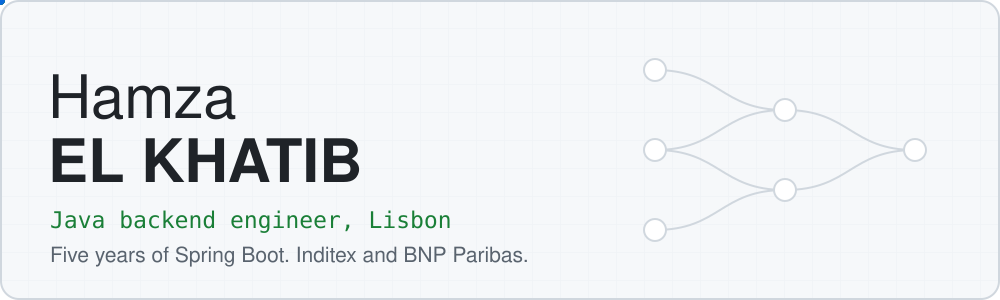
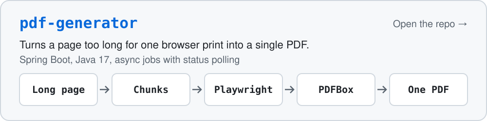
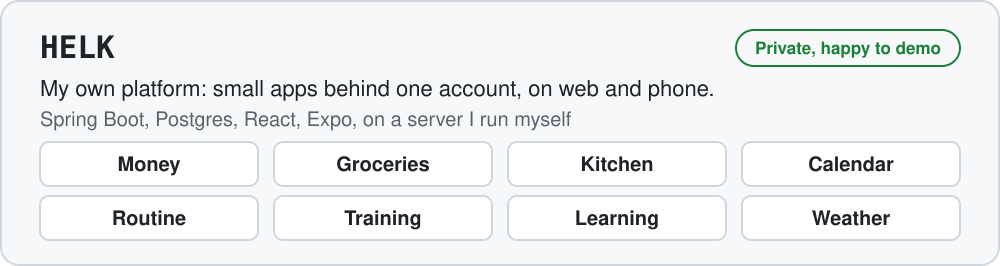

<picture><source media="(prefers-color-scheme: dark)" srcset="assets/hero-dark.svg"></picture>

## Work

### BNP Paribas, legal archiving via KCS iT

- Migrate clients from legacy solutions to the new implementation and set up new clients on the platform, across Java 6, 8 and 17.
- Built Jenkins pipeline stages for vulnerability and obsolescence scans, and look after releases, deployments and the Linux servers.

### Inditex via NTT DATA

<picture><source media="(prefers-color-scheme: dark)" srcset="assets/race-dark.svg"></picture>

- Took an endpoint from 30 seconds to 2. It called five APIs one after another over millions of rows. I ran the independent calls at the same time, split one huge method into smaller ones, and cached the responses that rarely change.
- Built the product PDF reports: Playwright renders the pages in chunks and PDFBox puts them together.

## On my own time

<a href="https://github.com/Hamza-EL-KHATIB/pdf-generator"><picture><source media="(prefers-color-scheme: dark)" srcset="assets/pdf-generator-dark.svg"></picture></a>

<picture><source media="(prefers-color-scheme: dark)" srcset="assets/helk-dark.svg"></picture>

## Stack

<picture><source media="(prefers-color-scheme: dark)" srcset="assets/stack-dark.svg"></picture>

## Contact

<a href="https://linkedin.com/in/hamza-el-khatib"><picture><source media="(prefers-color-scheme: dark)" srcset="assets/btn-linkedin-dark.svg"></picture></a>&nbsp;&nbsp;<a href="mailto:contact@hamzaelkhatib.com"><picture><source media="(prefers-color-scheme: dark)" srcset="assets/btn-email-dark.svg"></picture></a>

Arabic (native), English (C2), French (B2)
